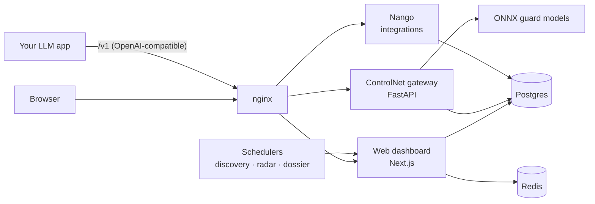

<h1 align="center">GOVERNLY</h1>

<p align="center">
  <b>Open-source AI governance: find every AI agent you run, guard every call, prove compliance.</b>
</p>

<p align="center">
  <a href="CHANGELOG.md"></a>
  <a href="LICENSE"></a>
  <a href="https://github.com/kentronai/Norix/actions/workflows/ci.yml"></a>
  <a href="docs/self-hosting.md"></a>
</p>

<p align="center">
  <a href="#quick-install">Quick install</a> ·
  <a href="#what-you-get">Features</a> ·
  <a href="#deploy-it">Deploy</a> ·
  <a href="#how-it-fits-together">Architecture</a> ·
  <a href="docs/README.md">Docs</a> ·
  <a href="CONTRIBUTING.md">Contributing</a>
</p>

Governly is a multi-tenant platform for governing AI in an organization. It discovers the AI agents and
models running across your cloud accounts and repositories, puts a guardrail gateway in front of LLM
calls, tracks regulations and vendors, and maps it all to compliance controls. Run it on your laptop or
your own server with one command.

## What you get

<table>
<tr><td><b>Agent Registry</b></td><td>Discovers AI agents across AWS (incl. EKS), GitHub and LangSmith, with an inventory and a risk dashboard per agent.</td></tr>
<tr><td><b>Guardrail gateway</b></td><td>ControlNet: an OpenAI-compatible API that runs guards on every request and response: PII, toxicity, jailbreak (ONNX models), JSON schema and tool-call checks, composed with a YAML policy DSL.</td></tr>
<tr><td><b>Model Registry</b></td><td>One catalog of the models your organization uses, from every provider.</td></tr>
<tr><td><b>Trust Dossier</b></td><td>Vendor profiles with subprocessor lists, tracked weekly.</td></tr>
<tr><td><b>AI Radar</b></td><td>Monitors regulators and standards bodies for AI regulation changes that affect you.</td></tr>
<tr><td><b>Regulations &amp; controls</b></td><td>Frameworks (EU AI Act, NIST AI RMF, ISO 42001 and more) collapsed into one control library.</td></tr>
<tr><td><b>Observability &amp; audit</b></td><td>Request logs, guard executions, violations and a full audit trail, per tenant.</td></tr>
<tr><td><b>Integrations</b></td><td>Connect providers through a self-hosted <a href="https://nango.dev">Nango</a>: credentials never sit in Governly's own tables.</td></tr>
</table>

## Quick install

You need **Docker** (with Compose 2.24+) on macOS or Linux, about 8 GB of RAM, and a free
**[Clerk](https://dashboard.clerk.com)** app for sign-in.

```bash
curl -fsSL https://raw.githubusercontent.com/kentronai/Norix/main/install.sh | bash
```

Or from a clone:

```bash
git clone https://github.com/kentronai/Norix.git && cd Norix
./install.sh
```

The installer asks for your two Clerk keys, generates every other secret locally, builds the images,
applies the database migrations and starts the stack. When it finishes, open **http://localhost** and
sign up.

```bash
./install.sh --doctor   # check prerequisites and running services
./install.sh            # re-run any time: it keeps your .env and upgrades in place
```

**Let your coding agent do it.** Tell Claude Code, Codex or Cursor:

> Read https://raw.githubusercontent.com/kentronai/Norix/main/docs/SKILL.md and set up Governly for me.

## Deploy it

| Where | How |
| --- | --- |
| **Any Linux server or VM** (AWS EC2, GCP, Azure, DigitalOcean, Hetzner…) | Run the same one-liner on the server with `GOVERNLY_URL=https://your.domain`, then put HTTPS in front. [Self-hosting guide](docs/self-hosting.md) |
| **Your laptop** | `./install.sh`, open http://localhost |
| **Development** (hot reload) | [Development guide](docs/DEVELOPMENT.md) |

A server needs 4 vCPU / 16 GB RAM to run the ML guard models comfortably; 2 vCPU / 8 GB works without
them. [Self-hosting](docs/self-hosting.md) covers HTTPS, backups, upgrades and every setting.

## How it fits together



| Path | What it is |
| --- | --- |
| `apps/web` | Dashboard: Next.js 15, React 19, shadcn/ui, Drizzle ORM, Clerk |
| `apps/controlnet` | Guardrail gateway: FastAPI, Composable Guard Algebra, YAML policies |
| `apps/onnx-service` | ONNX inference for ML guards |
| `apps/model-guard` | Model security scanner and SBOM generator |
| `packages/cga-sdk` | SDK for composing guards |
| `deploy/` | Self-host overlay used by `install.sh` |
| `docs/` | Guides and reference ([index](docs/README.md)) |

## Docs

- [Self-hosting](docs/self-hosting.md): install, HTTPS, Clerk, backups, upgrades
- [Configuration](docs/configuration.md): every environment variable
- [Architecture](docs/ARCHITECTURE.md) and the [Composable Guard Algebra](docs/CGA_GUIDE.md)
- [ControlNet API](docs/API.md)
- [Development](docs/DEVELOPMENT.md) and [contributing](CONTRIBUTING.md)
- [All docs](docs/README.md)

## Security

Report vulnerabilities privately: see [SECURITY.md](SECURITY.md). Stored provider credentials are
encrypted with AES-256-GCM under keys only your `.env` holds.

## License

[MIT](LICENSE). Copyright 2026 governly.
